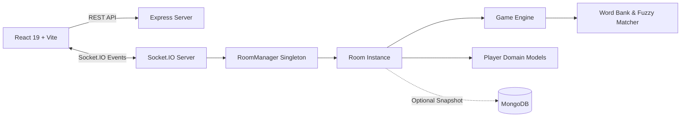

# Skribbl.io Clone - Real-Time Multiplayer Drawing Game

A full-stack, real-time multiplayer drawing and guessing game inspired by **Skribbl.io**. The application features an authoritative turn-based game loop, real-time canvas stroke synchronization, dynamic time-decay scoring, and a custom Object-Oriented game engine built with **React**, **Node.js**, **Express**, and **Socket.IO**.

---

## 🌐 Live Deployment

- **Live Frontend:** [https://skribbl-clone-6u0z.onrender.com](https://skribbl-clone-6u0z.onrender.com)
- **Backend API:** [https://skribbl-clone-api-1gcx.onrender.com/api/health](https://skribbl-clone-api-1gcx.onrender.com/api/health)

---

## 📸 Application Screenshots

### 1. Room Lobby and Configuration UI
Host creates rooms with custom settings (players, rounds, draw time, word count), custom avatar picker, and invite link/code.

```
┌────────────────────────────────────────────────────────────────────────┐
│                        🎮 SKRIBBL.IO CLONE                             │
│                                                                        │
│   Enter your name: [ Ayush          ]  Avatar: [ 🦊 ]                  │
│                                                                        │
│   ┌──────────────────────────────┐  ┌──────────────────────────────┐   │
│   │     🎲 Play (Public Room)    │  │   ➕ Create Private Room     │   │
│   └──────────────────────────────┘  └──────────────────────────────┘   │
│                                                                        │
│   Room Settings:                                                       │
│   • Players: 2 - 20        • Rounds: 2 - 10                            │
│   • Draw Time: 15 - 240s   • Word Choices: 3                           │
└────────────────────────────────────────────────────────────────────────┘
```

### 2. Real-Time Canvas Sync and Chat Guessing
Real-time stroke broadcast, color palette, brush sizes, undo/clear, letter hints, and anti-spoiler chat protection.

```
┌────────────────────────────────────────────────────────────────────────┐
│ ⏱️ 45s  │  ROUND 2 / 3  │  WORD: _ E _ G _ I _  │  Category: Animals   │
├─────────────────────────┬──────────────────────────────┬───────────────┤
│ 🏆 LEADERBOARD          │ 🖌️ CANVAS (800x600 Virtual)   │ 💬 LIVE CHAT  │
│                         │                              │               │
│ 1. Ayush    1,450 pts   │      [ Synchronized ]        │ Rahul: bird?  │
│ 2. Priya ✏️   980 pts   │      [ Real-Time    ]        │ Amit: cat?    │
│ 3. Rahul      820 pts   │      [ Drawing Area ]        │ Ayush guessed │
│ 4. Amit       640 pts   │                              │ the word! 🎉  │
│                         ├──────────────────────────────┤               │
│                         │ 🎨 Colors • Brush • Undo     │ [Type guess]  │
└─────────────────────────┴──────────────────────────────┴───────────────┘
```

### 3. Game Over and Winner Podium
Final scores, winner celebration, medal podium, and rematch options.

```
┌────────────────────────────────────────────────────────────────────────┐
│                         🎉 GAME OVER! 🎉                              │
│                                                                        │
│                     🥇 1st Place: Ayush (2,350 pts)                    │
│                     🥈 2nd Place: Priya (1,820 pts)                    │
│                     🥉 3rd Place: Rahul (1,410 pts)                    │
│                                                                        │
│                    [ Play Again ]   [ Return to Lobby ]                │
└────────────────────────────────────────────────────────────────────────┘
```

---

## 🏗️ Architecture Overview

The application follows a decoupled full-stack architecture designed for low latency and scalable multiplayer gameplay.



### 1. Frontend (React + Vite + HTML5 Canvas)
- **Room Creation & Management:** Seamless room creation with configurable settings, private invite links, and public matchmaking.
- **Game Phases UI:** Reactive states for `Lobby`, `Word Selection`, `Drawing`, `Round End`, and `Game Over`.
- **Responsive Interface:** Modern glassmorphism design with responsive controls for mobile and desktop screens.
- **Canvas Engine:**
  - Uses native HTML5 `<canvas>` with an internal $800 \times 600$ virtual coordinate space for resolution independence across all devices.
  - Captures touch/mouse events and streams stroke coordinates `(x0, y0, x1, y1)` and brush settings instantly over WebSockets.
  - Supports continuous drawing, brush sizes, eraser, 18-color palette, and **flood-fill (paint bucket)**.
- **Undo & Clear System:**
  - Synchronized stroke history on the server and client.
  - Replays canvas history on undo, clear, or when a player joins mid-round.

### 2. Backend Engine (Node.js + Express)
Acts as the authoritative game server:
- **Room Management:** Unique 6-character room codes, host permissions, participant roster, and automatic empty-room cleanup.
- **Turn Handling:** Queue-based turn management, rotating drawer selection, and 15-second word selection timeouts.
- **Timer Management:** Server-side 1-second countdown ticks preventing client-side timer manipulation.
- **Dynamic Score Calculation:** Time-decay scoring giving higher points for fast guesses.
- **State Synchronization:** Central source of truth for phases, hints, drawing history, and player scores.

### 3. Real-Time Communication (Socket.IO)
Provides low-latency bi-directional communication between clients and the server using room-scoped channels (`room:${code}`).

Key Events:
- `draw:stroke` — Real-time drawing coordinates streaming
- `draw:fill` — Bucket fill sync
- `draw:undo` — Undo last stroke
- `draw:clear` — Clear canvas buffer
- `draw:init` — Full drawing history replay for late-joining players
- `chat:message` — Player guesses and chat
- `game:correct_guess` — Notification when a player guesses the word
- `game:timer` — Countdown ticks
- `game:state` — Full game state synchronization

---

## 🚀 Core Features

### 🎮 Multiplayer Rooms
- **Configurable Settings:**
  - Players: 2–20
  - Rounds: 2–10
  - Draw Time: 15–240 seconds
  - Word Choices: 1–5 words
  - Hints: 0–5 progressive hints
  - Word Modes: Normal, Hidden
- **Room Access:** Join via direct invite link or 6-character room code.
- **Host Controls:** Host can start game, adjust settings, and kick players.

### 🔄 Turn-Based Gameplay
- **Drawer Rotation:** Tracks completed drawers in each round using a turn queue.
- **Word Selection:** Drawer receives 3 random words with a 15-second selection timer. Auto-picks if the drawer is idle.
- **Round End:** Round concludes when all guessers find the word or time expires.

### 🎨 Real-Time Drawing Tools
- **Pen / Brush:** Smooth drawing with customizable brush sizes (thin to thick).
- **Color Palette:** 18 vibrant colors to choose from.
- **Eraser:** Dedicated eraser tool to clear mistakes.
- **Paint Bucket:** Scanline flood-fill algorithm for enclosed areas.
- **Undo & Clear:** Undo previous strokes or wipe the entire canvas.

### 🧠 Intelligent Chat & Guessing System
- **Exact & Sanitized Matching:** Case-insensitive and trimmed word verification.
- **Anti-Spoiler Guard:** The drawer is blocked from typing the secret word in chat.
- **Guesser Isolation:** Players who already guessed the word can chat freely without spoiling it for remaining players.
- **Fuzzy Match Hints:** Detects near-miss guesses (edit distance of 1 via Levenshtein algorithm) and sends a private *"You are close!"* prompt.
- **Progressive Letter Hints:** Gradually reveals letter blanks (e.g., `_ _ a _ _`) at scheduled checkpoints.

### ⚡ Dynamic Scoring System
Points are awarded based on how quickly a player guesses the word:

$$\text{Points} = \text{Math.round}\left(100 + 400 \times \max\left(0, \frac{\text{timeLeft}}{\text{roundDuration}}\right)\right)$$

- **Guesser Points:** Up to **500 points** for an instant guess down to **100 points** at the last second.
- **Drawer Bonus:** Drawer earns **50 bonus points** for every player who guesses correctly.

### 🏆 Leaderboard & Winner Detection
- Real-time score ranking updated after each correct guess.
- End-of-round score breakdown.
- Final game leaderboard displaying winner podium and rankings.

---

## 🧩 Object-Oriented Design (OOP)

The backend server is structured cleanly around Object-Oriented Programming (OOP) principles:

```
server/src/game/
├── RoomManager.js    # Singleton coordinator for room lifecycle
├── Room.js           # Room session, host management, participant roster
├── Game.js           # Authoritative state machine, turns, timers, scoring
├── Player.js         # Participant domain model and score tracking
└── words.js          # Categorized word repository and fuzzy matcher
```

### 1. `RoomManager` (Singleton)
- Manages the lifecycle of active rooms across the server.
- Generates collision-free 6-character room codes.
- Maps `socket.id` to specific `Room` instances for instant event routing.
- Automatically cleans up inactive/empty rooms to prevent memory leaks.

### 2. `Room`
- Encapsulates room configuration (privacy, player limit, round count, draw time).
- Manages participants: handle joins, leaves, socket disconnections, and host reassignments.
- Owns and instantiates the `Game` instance.

### 3. `Game`
- State machine controlling transitions: `waiting` $\to$ `selecting` $\to$ `drawing` $\to$ `round_end` $\to$ `game_over`.
- Manages turn order queue and round rotation.
- Controls server-side timers for word selection (15s) and drawing (15–240s).
- Evaluates incoming guesses, triggers hints, and calculates dynamic scores.
- Maintains drawing stroke history for undo operations and late-joiner synchronization.

### 4. `Player`
- Encapsulates individual participant data:
  - Connection ID (`socket.id`)
  - Display Name & Custom Avatar
  - Score & Round Score
  - Status flags (`isHost`, `isDrawer`, `hasGuessed`, `isConnected`)

---

## 🛠️ Technology Stack

| Layer | Technology | Purpose |
| :--- | :--- | :--- |
| **Frontend** | React 19, Vite, React Router | Fast client-side rendering and routing |
| **Styling** | Modern CSS3 (Glassmorphism) | Custom responsive UI styling |
| **Canvas** | HTML5 Canvas API | Low-overhead vector rendering & flood-fill |
| **Backend** | Node.js, Express 5 | Authoritative server & REST API |
| **Real-Time** | Socket.IO 4 | WebSocket bi-directional state synchronization |
| **Database** | MongoDB, Mongoose (Optional) | Room snapshots and metadata persistence |
| **Deployment** | Render | Cloud hosting for frontend and backend |

---

## 📁 Project Structure

```text
skribbl-clone/
├── client/                               # Frontend React + Vite Application
│   ├── public/                           # Static assets
│   ├── src/
│   │   ├── assets/                       # Audio effects & images
│   │   ├── components/                   # Reusable UI components
│   │   │   ├── Avatar.jsx                # Player avatar customization
│   │   │   ├── Canvas.jsx                # HTML5 drawing engine & tools
│   │   │   ├── Canvas.css                # Canvas layout & toolbar styles
│   │   │   ├── Chat.jsx                  # Chat and guess box
│   │   │   ├── CreateRoomModal.jsx       # Room settings dialog
│   │   │   ├── GameOverModal.jsx         # Winner announcement & leaderboard
│   │   │   ├── Leaderboard.jsx           # Live score ranking sidebar
│   │   │   ├── RoundEndModal.jsx         # Round intermission modal
│   │   │   ├── TopBar.jsx                # Timer, word blanks & round info
│   │   │   └── WordSelectModal.jsx       # 3-word selection dialog
│   │   ├── pages/
│   │   │   ├── Home.jsx                  # Landing page (Join / Create / Quick Play)
│   │   │   └── Room.jsx                  # Main multiplayer room page
│   │   ├── services/
│   │   │   ├── api.js                    # Axios REST client
│   │   │   └── socket.js                 # Socket.IO connection client
│   │   ├── utils/
│   │   │   ├── constants.js              # Palette colors & brush sizes
│   │   │   └── sound.js                  # Sound synthesizers & effects
│   │   ├── App.jsx                       # Route setup
│   │   ├── App.css                       # Global styles
│   │   └── main.jsx                      # React entry point
│   ├── package.json
│   └── vite.config.js
│
├── server/                               # Authoritative Node.js Server
│   ├── src/
│   │   ├── config/
│   │   │   └── db.js                     # MongoDB connection (optional)
│   │   ├── game/                         # OOP Game Logic
│   │   │   ├── Game.js                   # Round cycles, scoring & timers
│   │   │   ├── Player.js                 # Player model & score state
│   │   │   ├── Room.js                   # Room management & host controls
│   │   │   ├── RoomManager.js            # Singleton registry for active rooms
│   │   │   └── words.js                  # Word bank & fuzzy Levenshtein match
│   │   ├── models/
│   │   │   └── Room.js                   # Mongoose schema (optional)
│   │   ├── routes/
│   │   │   └── roomRoutes.js             # REST API (/api/rooms)
│   │   └── index.js                      # Express & Socket.IO server entry
│   └── package.json
│
├── docs/                                 # Documentation & Assignment PDF
│   ├── Skribbl_Clone_Documentation.pdf   # Formatted project documentation PDF
│   └── skribbl-io-intern-assignment.pdf  # Original intern assignment PDF
├── package.json                          # Monorepo scripts
└── README.md                             # Project README
```

---

## 💻 Local Setup & Installation

### Prerequisites
- **Node.js** (v18.x or newer)
- **npm** (v9.x or newer)
- *(Optional)* **MongoDB** (runs in in-memory mode if not provided)

---

### 1. Start the Backend Server

```bash
# Navigate to the server directory
cd server

# Install dependencies
npm install

# Start development server with nodemon
npm run dev
```

The backend server will run on:
```
http://localhost:5000
```

> **Optional Environment Variables (`server/.env`):**
> ```env
> PORT=5000
> CLIENT_URL=http://localhost:5173
> MONGODB_URI=mongodb://localhost:27017/skribbl
> ```

---

### 2. Start the Frontend Client

```bash
# Open a new terminal and navigate to client
cd client

# Install dependencies
npm install

# Configure environment variable
# Create a .env file inside /client with:
# VITE_API_URL=http://localhost:5000

# Start Vite development server
npm run dev
```

The frontend application will run on:
```
http://localhost:5173
```

---

### 3. Play Multiplayer Locally
1. Open `http://localhost:5173` in Browser Window 1.
2. Enter your name, customize your avatar, and click **Create Private Room**.
3. Copy the room code or invite link.
4. Open an **Incognito / Private Window** (or a second browser) at `http://localhost:5173`.
5. Enter a different name and join with the room code.
6. Click **Start Game** on the host's screen to begin!

---

## 👨‍💻 Author

**Designed and Developed by Ayush Saxena**

- 💼 **LinkedIn:** [ayush-saxena-developer](https://www.linkedin.com/in/ayush-saxena-developer)
- ---
